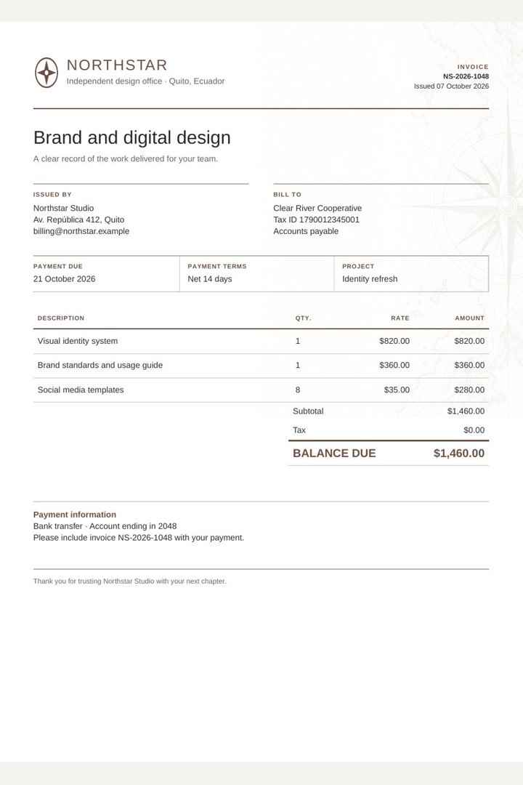
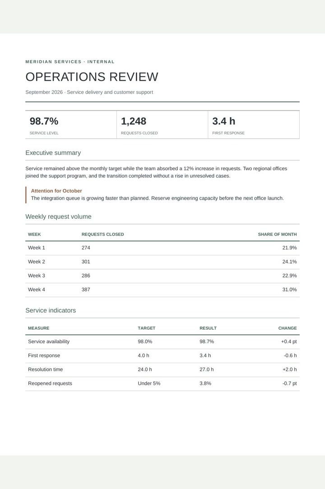
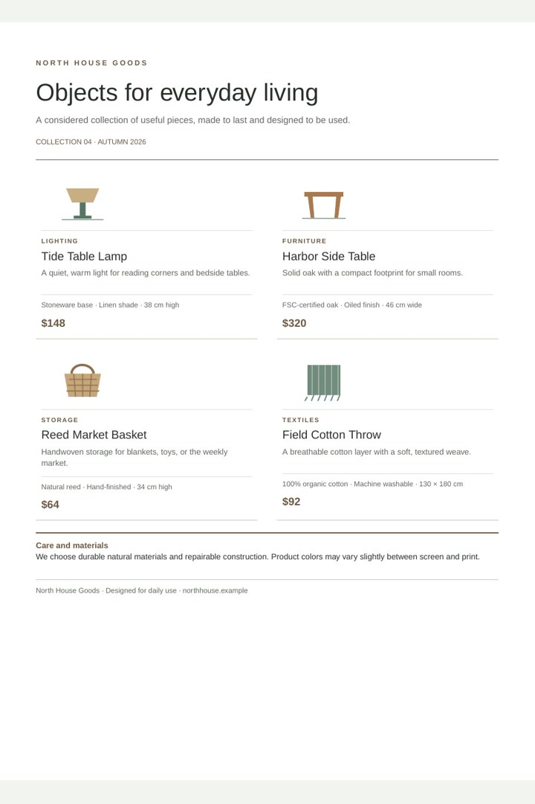
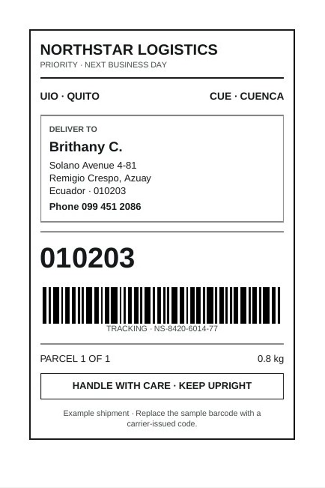
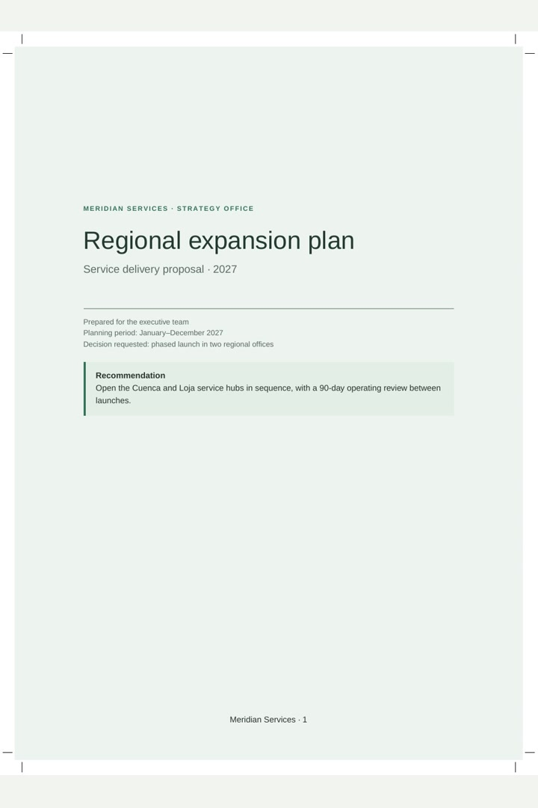

# Pagecraft

Pagecraft turns HTML and a practical subset of CSS into paginated PDF documents. It is built for things like invoices, reports, forms, catalogs, and shipping labels: documents where page size, pagination, and readable output matter.

The rendering engine is written in Go and is inspired by [WeasyPrint](https://weasyprint.org/). Pagecraft offers two ways to use the same renderer: a command-line program for any language that can start a process, and a Go package for applications written in Go. The CLI is a small wrapper around the library, so both produce PDFs through the same engine.

## Install

Install the command with Go:

```sh
go install github.com/robtrivi/pagecraft/cmd/pagecraft@latest
```

This places the `pagecraft` executable in your Go binary directory. You can also build it from a checkout:

```sh
go build -o pagecraft ./cmd/pagecraft
```

### Download a prebuilt binary

Download the asset for your operating system and CPU from the [latest release](https://github.com/robtrivi/pagecraft/releases/latest). Choose `linux`, `darwin` (macOS), or `windows`, followed by `amd64` for Intel/AMD 64-bit CPUs or `arm64` for 64-bit ARM CPUs. Windows assets end in `.exe`. These binaries are standalone; Go does not need to be installed.

On Linux or macOS, make the downloaded file executable and pass it an HTML file:

```sh
chmod +x pagecraft-v1.0.0-linux-amd64
./pagecraft-v1.0.0-linux-amd64 -o report.pdf report.html
```

For macOS, use the matching `darwin-amd64` or `darwin-arm64` asset. On Windows PowerShell, run the `.exe` directly:

```powershell
.\pagecraft-v1.0.0-windows-amd64.exe -o report.pdf report.html
```

Replace `v1.0.0` and the OS/architecture suffix with the values in the asset you downloaded.

## Use the command

Render an HTML file and choose where to write the PDF:

```sh
pagecraft -o report.pdf report.html
```

With no input file, Pagecraft reads HTML from standard input and writes the PDF to standard output. This makes it easy to connect to other tools:

```sh
cat report.html | pagecraft > report.pdf
```

The output file is optional. Use `-o -` to write to standard output explicitly. Errors go to standard error and return a non-zero exit code.

```text
Usage: pagecraft [options] [input.html]

Options:
  -o path    write PDF to this file (default: stdout; use - for stdout)
```

When the input is a file, relative stylesheets, images, and fonts are resolved from that file's directory. An explicit HTML `<base>` element takes precedence. For HTML from stdin, relative resources are resolved from the process working directory.

## Run Pagecraft as a service

For applications outside Go that render PDFs frequently, keep Pagecraft running and send it one HTML document per request:

```sh
pagecraft serve -addr 127.0.0.1:8080 -workers 4
```

The service exposes `POST /render` and returns `application/pdf`. `GET /healthz` returns `ok` when the service is available. The default worker count is the Go runtime's `GOMAXPROCS`; set `-workers` to cap simultaneous renders. The maximum request body defaults to 10 MiB. Configure it in bytes with `-max-body-bytes`, or directly in mebibytes with `-max-body-mib`:

```sh
pagecraft serve -max-body-mib 90
```

Here, `90` means 90 MiB (94,371,840 bytes). If both size flags are provided, `-max-body-mib` takes precedence.

```sh
curl --data-binary @invoice.html \
  -H 'Content-Type: text/html; charset=utf-8' \
  http://127.0.0.1:8080/render \
  -o invoice.pdf
```

A Java service can build the HTML from its own data and templates, then reuse an HTTP client to send each document:

```java
HttpRequest request = HttpRequest.newBuilder(URI.create("http://127.0.0.1:8080/render"))
    .header("Content-Type", "text/html; charset=utf-8")
    .POST(HttpRequest.BodyPublishers.ofString(html))
    .build();

HttpResponse<byte[]> response = HttpClient.newHttpClient().send(
    request, HttpResponse.BodyHandlers.ofByteArray());
if (response.statusCode() != 200) {
    throw new IOException("Pagecraft returned HTTP " + response.statusCode());
}
Files.write(Path.of("invoice.pdf"), response.body());
```

The server binds to loopback by default. Only send it trusted HTML, and restrict network access if binding it to another interface. Add a `<base href="...">` to HTML that refers to relative resources.

### Call it from another language

For example, a Python application can invoke Pagecraft and pass HTML through stdin:

```python
import subprocess

html = b"<h1>Monthly report</h1><p>Generated by Pagecraft.</p>"
with open("report.pdf", "wb") as pdf:
    subprocess.run(["pagecraft"], input=html, stdout=pdf, check=True)
```

The same process interface works from JavaScript, Ruby, PHP, Rust, shell scripts, and other languages. Applications that need a persistent service or a language-specific binding can build those around the executable or the Go package.

## Use from Go

Add Pagecraft to a Go project:

```sh
go get github.com/robtrivi/pagecraft
```

The Go API returns the PDF as a byte slice:

```go
package main

import (
 "os"

 "github.com/robtrivi/pagecraft/render"
)

func main() {
 pdf, err := render.RenderHTMLToPDF(`<style>@page { size: A4; margin: 20mm; }</style>
<h1>Monthly report</h1><p>Generated by Pagecraft.</p>`)
 if err != nil {
  panic(err)
 }
 if err := os.WriteFile("report.pdf", pdf, 0o644); err != nil {
  panic(err)
 }
}
```

## Supported layout

Pagecraft supports HTML stylesheets and inline styles, physical page sizes and margins through `@page`, page footers with page counters, text wrapping, lists, tables, floats, flexbox, grid, and multi-page layout. It can render borders, backgrounds, common typography, PNG and JPEG images, SVG graphics, links, metadata, and TrueType fonts declared with `@font-face`.

Pagecraft implements a document-focused CSS subset, not a browser. Unsupported CSS may be ignored or render differently from Chromium. The [`examples/`](examples/) directory has complete HTML documents for an [invoice](examples/invoice.html), an [operations report](examples/operations-report.html), a [product catalog](examples/product-catalog.html), a [shipping label](examples/shipping-label.html), and a [regional expansion plan with landscape appendices](examples/regional-expansion-plan.html).

### Example previews

Each preview shows the first page rendered by Pagecraft. Select a preview to open its HTML source.

<table>
  <tr>
    <td width="50%" align="center"><a href="examples/invoice.html"><br /><strong>Invoice</strong></a></td>
    <td width="50%" align="center"><a href="examples/operations-report.html"><br /><strong>Operations report</strong></a></td>
  </tr>
  <tr>
    <td width="50%" align="center"><a href="examples/product-catalog.html"><br /><strong>Product catalog</strong></a></td>
    <td width="50%" align="center"><a href="examples/shipping-label.html"><br /><strong>Shipping label</strong></a></td>
  </tr>
  <tr>
    <td width="50%" align="center"><a href="examples/regional-expansion-plan.html"><br /><strong>Regional expansion plan</strong></a></td>
    <td width="50%"></td>
  </tr>
</table>

## Development

Run the test suite and static checks:

```sh
go test ./...
go vet ./...
```

## License

GNU GPL version 3 or later (`GPL-3.0-or-later`). See [`LICENSE`](LICENSE).
